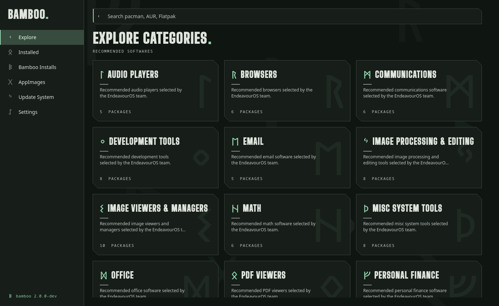
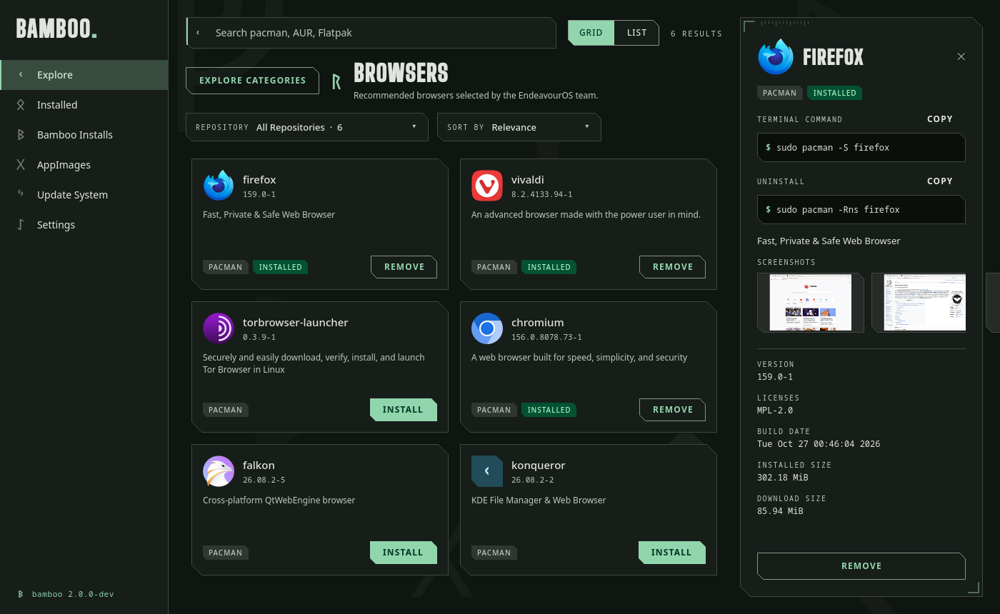
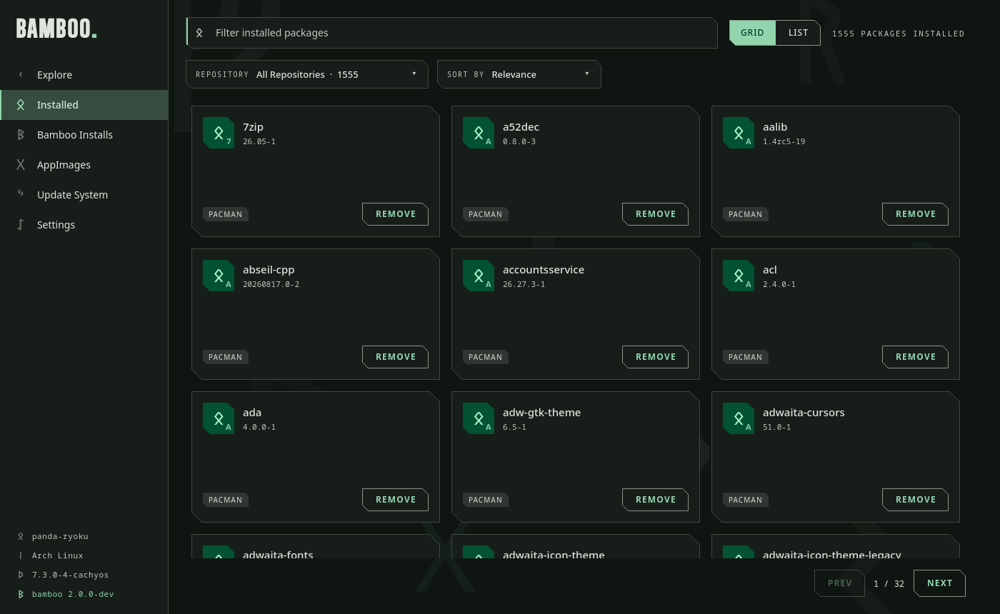
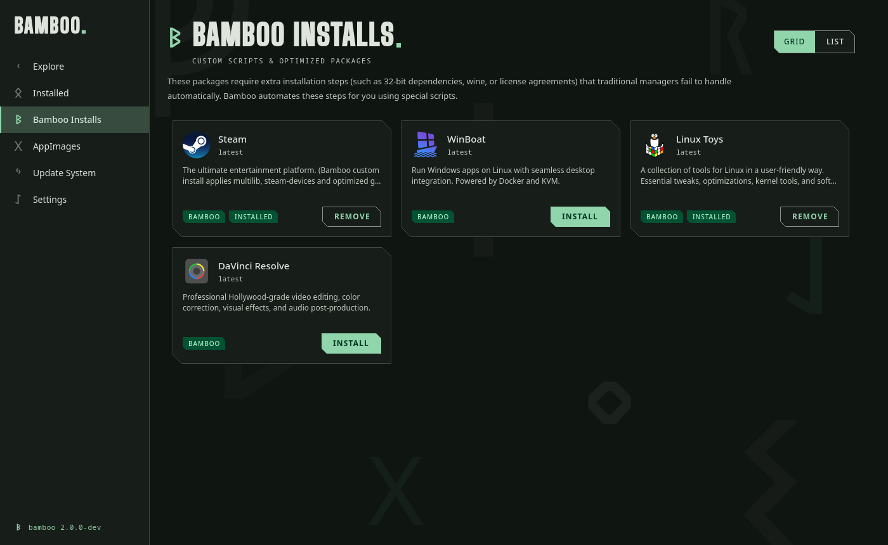
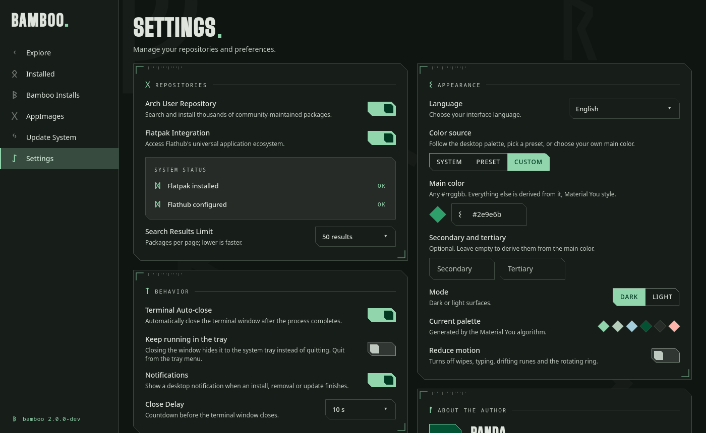

# 🐼 Bamboo End Store (Community Edition)

<p align="center">
  
</p>

<p align="center">
    <a href="https://github.com/satodu/bamboo-end-store/releases">
        
    </a>
    <a href="LICENSE">
        
    </a>
    <a href="https://satodu.github.io/bamboo-end-store/">
        
    </a>
</p>

A fast, console-first software store for **EndeavourOS / Arch Linux**, written in **Rust** with a **Qt/QML** interface.

Designed and crafted for **EndeavourOS** users by a devoted daily user of the system, as a tribute and a tool to improve the desktop experience.

> [!IMPORTANT]
> **UNOFFICIAL FAN PROJECT**: this application is not an official product of any Linux distribution team. It is a fan-made project created by **Panda**.

> [!NOTE]
> Version 2 is a complete rewrite. The 1.x series (Laravel, Livewire and NativePHP/Electron) is kept in the git history and under the tag `v1.4.2-php`.

---

## 📸 Screenshots

<p align="center">
  
  
</p>
<p align="center">
  
  
</p>
<p align="center">
  
</p>

---

## ✨ Features

- **Console first**: every package shows the exact command it stands for (`sudo pacman -S`, `yay -S`, `flatpak install flathub`) with a copy button, and installs run in a visible terminal. Nothing happens behind your back.
- **Three sources in one search**: official repositories, the AUR and Flatpak, with filters by repository, sorting, counts per repository and pagination.
- **Curated categories** from the EndeavourOS quickstart list, each one with a rune, plus the official EndeavourOS tools when your system has them.
- **Package details**: description, sizes, license, screenshots with a full-window viewer, and the AUR community comments.
- **Installed packages**: pacman, AUR and Flatpak in one list, filterable.
- **Bamboo Installs**: Steam, WinBoat, Linux Toys and DaVinci Resolve with their extra setup scripts (multilib, Wine, 32-bit libraries).
- **AppImages**: add by file picker or drag and drop, integrate into the menu (`.desktop` entry and icon), launch and remove.
- **Flatpak setup**: checks the `flatpak` binary and the Flathub remote and fixes them from Settings.
- **System update** in one click: `eos-update` or your AUR helper, then Flatpak, then orphaned packages.
- **Material You theming**: follows your desktop palette, a preset (Bamboo, Catppuccin, Nord, Gruvbox) or any color you choose. No `matugen` needed.
- **Four languages**: English, Portuguese, Spanish and Russian.
- **Desktop integration**: notifications when an operation ends, a system tray icon, machine info in the sidebar.
- **The Galdr look**: chamfered panels, real Elder Futhark runes as icons, calm diagonal wipes. Motion can be turned off.

---

## 📦 Installation

### Build from source

Requirements on Arch / EndeavourOS:

```bash
sudo pacman -S --needed base-devel rust qt6-base qt6-declarative qt6-svg qt6-wayland
```

Then:

```bash
git clone https://github.com/satodu/bamboo-end-store.git
cd bamboo-end-store
./run.sh --release     # or: cargo run --release -p bamboo-end-store
```

The first build takes a few minutes. Settings live in `~/.config/bamboo-end-store/settings.json`; an old 1.x settings file is read automatically.

### AUR

From the AUR: `yay -S bamboo-end-store-bin` (or `paru`), the prebuilt release, installs in seconds. `bamboo-end-store` builds the same release from source (a few minutes; its `PKGBUILD` is in `packaging/aur/`). The two conflict, install one.

---

## 🛠️ Development

```bash
./run.sh                             # debug build; --clean (throwaway settings), --still, --gallery, --test
cargo test -p bamboo-core            # unit tests, parsers on real captured output, i18n checks
cargo run -p bamboo-end-store        # the app
cargo run -p bamboo-core --example cli -- aur search yay    # the core without the UI
BAMBOO_QML=app/qml/Gallery.qml cargo run -p bamboo-end-store # component catalogue
```

| Folder | What is in it |
|---|---|
| `core/` | Rust core, no Qt: package managers, store, settings, cache, terminal, AppImages, themes, i18n |
| `app/` | Qt/QML app: cxx-qt bridges in `src/`, QML in `qml/`, bundled fonts and icons |
| `docs/` | the project website |

Project rules (visual language, QML pitfalls, tests that never touch your data) are in [`AGENTS.md`](AGENTS.md).

---

## 🛡️ License

This project is open-source and available under the **MIT License**.

```
MIT License

Copyright (c) 2024-2026 Panda (satodu)

Permission is hereby granted, free of charge, to any person obtaining a copy
of this software and associated documentation files (the "Software"), to deal
in the Software without restriction, including without limitation the rights
to use, copy, modify, merge, publish, distribute, sublicense, and/or sell
copies of the Software, and to permit persons to whom the Software is
furnished to do so, subject to the following conditions:

The above copyright notice and this permission notice shall be included in all
copies or substantial portions of the Software.

THE SOFTWARE IS PROVIDED "AS IS", WITHOUT WARRANTY OF ANY KIND, EXPRESS OR
IMPLIED, INCLUDING BUT NOT LIMITED TO THE WARRANTIES OF MERCHANTABILITY,
FITNESS FOR A PARTICULAR PURPOSE AND NONINFRINGEMENT. IN NO EVENT SHALL THE
AUTHORS OR COPYRIGHT HOLDERS BE LIABLE FOR ANY CLAIM, DAMAGES OR OTHER
LIABILITY, WHETHER IN AN ACTION OF CONTRACT, TORT OR OTHERWISE, ARISING FROM,
OUT OF OR IN CONNECTION WITH THE SOFTWARE OR THE USE OR OTHER DEALINGS IN THE
SOFTWARE.
```

## 🤝 Credits

Created with ❤️ by **Panda**.
Inspired by the strength and versatility of **Bamboo**.

Heartfelt thanks to the **EndeavourOS** team and community for providing such an amazing Linux distribution. This application was built and designed specifically for EndeavourOS users by a devoted fan who uses this OS daily!

The visual language comes from the **Galdr** design system. Color schemes use Google's Material Color Utilities through the `material-colors` crate.
